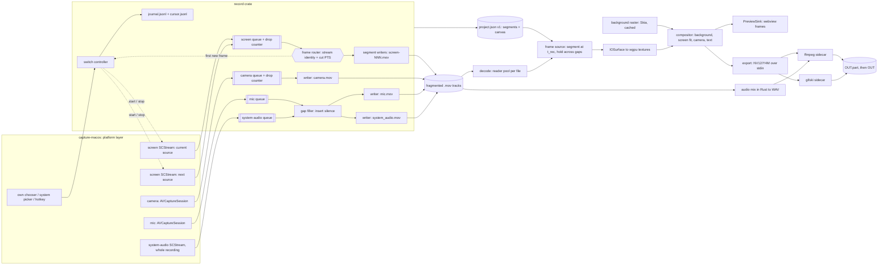

# Architecture

This document describes how Simple Capture is built, and it is the build reference for M1 (macOS
recording). It is the M0 plan (research notes plus spikes, measured on macOS only) updated with the
decisions of 2026-11-19: the output canvas (ADR-033), the screen track as segments with source
switching (ADR-034), the separate system-audio stream (ADR-035), webview-frame preview everywhere
(ADR-007 update), the system picker as a source (ADR-028 update), our own Windows/Linux helper
builds (ADR-013) and no signing identity (ADR-003 update). docs/SPEC.md is the source of truth, and
docs/DECISIONS.md records every choice made here (ADR-nnn). Anything marked *untested* has no spike
evidence yet.

Source keys are the same as in DECISIONS.md:
- [S1]–[S4] are `spikes/01-helpers`, `02-preview-transport`, `03-macos-pipeline` and `04-skia-text`.
- [S3b] is the source-switching spike, `spikes/03-macos-pipeline/REPORT-swap.md`.
- [S5] and [S6] are `spikes/05-native-preview-windows` and `06-native-preview-linux`.
- [cap-recording], [canvas-and-source-switching], [pickers-and-hotswap] and similar keys are the
  notes in `docs/research/`. Where a note or report has an "Independent verification" section, that
  section overrides the text above it, and this document uses the corrected figures.

All numbers come from an M3 Pro. Nothing was measured on the base M1 8 GB target. [S3b] ran on a
busy machine (load average 4.9–12.2 at the start of each round).

---

## 1. Workspace layout

This is the spec's suggested layout plus the `geometry` and `preview` crates (ADR-030), the
dev-profile `opt-level` (ADR-031) and the project-folder name in §6 (ADR-032), all accepted on
2026-11-19. The `PreviewSink` trait follows ADR-007.

```
simple-capture/
├─ Cargo.toml                 workspace; [profile.dev.package."*"] opt-level = 3 (ADR-031)
├─ justfile                   setup · helpers (fetch/build/verify) · run (app via the dev host)
│                             · test · bundle
├─ .github/workflows/         CI: macOS arm64, Windows x64, Ubuntu x64 (from M1)
├─ crates/
│  ├─ core/                   project model and project.json v1 (serde): screen segments,
│  │                          source descriptors, output canvas, EDL, text; journal event types;
│  │                          commands + undo/redo; time types (HostTime, RecTime, TlTime);
│  │                          atomic file writes
│  ├─ geometry/               pure layout → pixel rects: canvas fit (contain; cover later),
│  │                          reference canvas size, export size presets, crops, radii, mirror,
│  │                          snapping, even sizes, cursor normalisation. No GPU dependency
│  ├─ platform/               traits: ScreenSource, SourcePicker, SystemAudioSource, CameraSource,
│  │                          AudioSource, TrackWriter, Decoder, OverlayWindow, Permissions,
│  │                          PreviewSink; capability flags; synthetic sources for tests
│  ├─ capture-macos/          objc2 (ADR-006): SCK screen streams (video only), the system-audio
│  │                          SCStream (ADR-035), SCContentSharingPicker, AVCaptureSession camera
│  │                          + mic, AVAssetWriter writers, AVAssetReader decoder,
│  │                          IOSurface → Metal import
│  ├─ capture-windows/        placeholder until M6 (compiles, returns Unsupported, tests pass)
│  ├─ capture-linux/          placeholder until M6
│  ├─ record/                 session orchestration (OS-independent; drives platform traits):
│  │                          start gate, queues, health, pause, stop; the switch controller and
│  │                          frame router (segments, make-before-break); audio gap filler
│  │                          (silence); journal; recovery scan
│  ├─ decode/                 Decoder users: keyframe index, reader pool per file, frame cache,
│  │                          segment-aware frame lookup
│  ├─ render/                 wgpu compositor + CPU reference renderer + YUV import shaders;
│  │                          canvas pass (background → screen segment → camera → text)
│  ├─ text/                   everything Skia (FreeType build, ADR-018): text layout/raster,
│  │                          font registry, text cache, and the background rasterizer
│  │                          (solid, gradients, image)
│  ├─ player/                 timeline→source mapping, prefetch, audio clock, cpal output, mix
│  ├─ preview/                PreviewSink impls: WebviewFrames (all OSes); native slots per OS,
│  │                          off until proven on hardware (ADR-007)
│  ├─ export/                 offline render loop, audio mix to WAV, recipes, estimates, probe
│  └─ helpers/                sidecar process management: spawn, pipes, progress, cancel, .part
├─ app/                       Tauri 2.12.x shell: commands, windows (recorder panel, floating
│                             bar, switch-source popover, pick-mode and region overlays), tray,
│                             hotkeys
├─ ui/                        Svelte 5 + TypeScript + Vite (ADR-005)
├─ cli/                       simple-capture (--self-test, probe dump)
├─ third_party/               helper build scripts, versions.toml (pinned + SHA-256), licenses
└─ tools/macos-dev-host/      the single permission host for dev binaries (ADR-002)
```

Where the new design lives:
- **Canvas.** Types in `core` (`output.canvas`, §6). Fit math, reference size and size presets in
  `geometry` (§8, §10). Background raster in `text`, because Skia and its FreeType build settings
  stay in one crate. The canvas pass in `render`, in both the GPU and CPU paths.
- **Segments and switching.** Segment and source-descriptor types and journal events in `core`.
  The switch controller, frame router, segment writer lifecycle and recovery in `record`, so the
  logic is OS-independent and runs in CI against synthetic sources. Stream creation, the picker and
  the per-OS switch mechanics in `capture-*` behind `ScreenSource` and `SourcePicker`.
- **Silence insertion.** Gap detection in `record` (every OS). Writing the silent samples is a
  `TrackWriter` method implemented per OS, because the sample-buffer format is platform-specific.

Notes:
- `geometry` is separate so UI hit tests, the CPU reference renderer and unit tests can use it
  without pulling in wgpu. `preview` is separate because the transport differs per OS (ADR-030).
- The `text` crate's `.cargo/config.toml` (or the workspace's) sets `FORCE_SKIA_BUILD` and the
  FreeType GN arguments (ADR-018).
- M1 needs more crates than the recorder alone: the quick export composites segments over a
  background (§10), so `decode`, `render` and `text` (for the background raster) are M1 work, and
  the Skia FreeType build is part of the M1 CI skeleton on all three OSes.
- `SourcePicker` is the cross-platform "System picker…" entry recommended in
  [pickers-and-hotswap]; on macOS it wraps `SCContentSharingPicker`, which needs the main thread.

---

## 2. Per-OS backends

| Job | macOS (status) | Windows (M6, untested) | Linux (M6, untested) |
|---|---|---|---|
| Screen | ScreenCaptureKit via objc2, 420v, queueDepth 6, **video only**, one SCStream per segment (ADR-034, ADR-035). **Verified [S3]** for display and single-window capture. Region by `sourceRect` on a display filter was used in [S3b] (1120×640 segments, correct size). **M1:** display, window, application (new windows picked up in 66–77 ms) and region by `sourceRect` (Retina and odd sizes floored to even px) all verified live; crop not needed | Windows.Graphics.Capture via `CreateForWindow` / `CreateForMonitor`: windows-capture (MIT) or vendored scap-direct3d, decided in M6 [cap-mit-crates]. Region = cropped monitor capture | xdg-desktop-portal ScreenCast (ashpd) + PipeWire; `persist_mode` 2, re-save the single-use restore token [ecosystem]. Region = crop of a monitor (KDE can also return its own region) |
| System picker (ADR-028) | `SCContentSharingPicker` (14.0+): configured and read back in [S3b] but **never presented**. `excludedWindowIDs` for our UI, `present(for: stream)` for switching | `GraphicsCapturePicker` via `IInitializeWithWindow` (1803+); one window or one display, no exclusion list. windows-capture 2.0.1 already wraps it [pickers-and-hotswap] | The portal dialog itself (mandatory on Wayland), `multiple = true`, MONITOR \| WINDOW |
| Switching source while recording (ADR-034) | Make-before-break: new SCStream, cut on its first frame, then stop the old one. Gap 0–28 ms ([S3b]; 14–22 ms in the verifier run). `updateConfiguration` only for region changes on the same display (7–28 ms) | New WGC frame pool + session per switch, started before the old one ends; two yellow borders show briefly | Sources pre-selected with `multiple = true` switch with no dialog. Any other source needs a new portal session and dialog; the screen holds its last frame meanwhile |
| System audio | **A dedicated audio-only SCStream** for the whole recording (ADR-035): 0 gaps over 1 ms in 10 of 10 runs plus 3 of 3 re-runs [S3b]. `excludesCurrentProcessAudio`. "All" **verified [S3]**; "Only the captured app" built in M1 (`updateContentFilter`, 144–178 ms per change); isolates bundled apps, unbundled processes are grouped by SCK (ADR-010) | WASAPI loopback; process loopback on build 20348+ | PipeWire `stream.capture.sink=true` [ecosystem] |
| Audio gaps (ADR-035) | Silence inserted before AVAssetWriter, whose AAC input otherwise closes timestamp gaps (files 0.08–0.48 s short [S3b]) | same rule, in the same `record` code | same rule |
| Camera | AVCaptureSession, ≤1080p30 420v (**verified [S3]**; M1: device notifications update the list, real hot-plug is an owner step) | MF + DirectShow fallback, vendored from Cap's MIT crates (ADR-023) | V4L2 / portal camera |
| Mic | AVCaptureSession, host-time timestamps (**verified [S3]**; 0 gaps in 15 of 15 runs plus 5 re-runs [S3b]; M1: hot-plug via notifications; Mic Mode built, run live only on request) | WASAPI via cpal | PipeWire via cpal |
| Screen consent | TCC Screen Recording grant for our own chooser (`SCShareableContent`). The picker path may work without the grant (video only; secondary source, untested) | None needed for `CreateForWindow` / `CreateForMonitor` in unpackaged apps; the picker is its own consent | The portal dialog; restore token skips it next time |
| Raw-track encode | AVAssetWriter → VideoToolbox HEVC / AudioToolbox AAC, fragmented .mov (**verified [S3]**, per segment [S3b]) | MF hardware MFT (async unlock required [ecosystem]) | FFmpeg LGPL libraries built by us with `--disable-network` (ADR-013) (VAAPI/NVENC), else x264 via the helper |
| Editor decode | AVAssetReader → IOSurface NV12 (**verified [S3]**) | MF Source Reader (DXVA) | FFmpeg LGPL libraries built by us (+VAAPI) |
| Frames into wgpu | CVMetalTextureCache → R8 + RG8 → wgpu-hal `texture_from_raw`, zero-copy (**verified [S3]**) | Probably CPU upload in v1; Cap's D3D11 sharing path appears unused [cap-render-decode] | CPU upload (dmabuf later) |
| Preview transport (ADR-007) | **Webview frames** (URI pull, WebGL2). Native CAMetalLayer under the webview works [S2] but is off | **Webview frames.** Native DirectComposition visual compiles [S5], never run | **Webview frames.** Wayland `wl_subsurface` passed in Docker with software rendering [S6]; X11 native child failed, so X11 stays on webview frames |
| Own-UI exclusion | SCContentFilter with our windows listed one by one, on every stream (**verified [S3]**) | SetWindowDisplayAffinity(WDA_EXCLUDEFROMCAPTURE), set when each window is created | Auto-hide overlapping overlays |
| Hotkeys | tauri-plugin-global-shortcut | same | GlobalShortcuts portal on Wayland, global-hotkey on X11 |
| Export | FFmpeg 9.0.2 static GPL sidecar + gifski sidecar (**verified [S1]**) | FFmpeg built by us from pinned sources with `--disable-network` + gifski built with cargo (ADR-013); not built yet | same as Windows |

M1 CI may skip helper builds on Windows and Linux; those helpers come later (ADR-013). The
placeholder capture crates there must still compile and pass tests.

---

## 3. Data flow



- Only the screen is segmented. Camera, mic and system audio are one continuous file each for the
  whole recording (ADR-034).
- Thumbnails, the recorder panel's still mini preview and the live camera bubble use the same
  compositor, so the preview always matches the output.

---

## 4. Recording: threads, queues, buffers

```
SCK screen stream, tag n ─────try_send─┐
SCK screen stream, tag n+1 ───try_send─┴► [screen queue, cap N, drops counted] ─► screen writer thread
                                                                    (router: tag + cut PTS; appends)
                                                    closing segment: hold + finishWriting ─► finisher thread
SCK system-audio stream ──────push─────► [sys queue, generous] ─► gap filler ─► sys writer thread
AVCapture video queue ────────try_send─► [camera queue, cap N, drops counted] ─► camera writer thread
AVCapture audio queue ────────push─────► [mic queue, generous] ─► gap filler ─► mic writer thread
                                   │
switch controller (record control thread) ◄── switch requests (popover, tray, hotkey, picker observer)
health monitor (1 Hz): fps, drops, writer readiness, free disk, per track and segment ─► UI + journal
```

- **Capture callbacks do no work.** They retain the sample buffer, tag it with the stream's
  identity and `try_send` it. Nothing runs on the UI thread (Pitfall 13). The picker itself must be
  presented on the main thread; its observer only forwards the picked filter to the controller.
- **Video may drop.** When a video queue is full, the newest frame is dropped and counted. Cap uses
  60-frame channels [cap-recording]. Our sizes are tuned in M1, keeping SCK's queueDepth (6) in
  mind.
- **Audio never drops silently.** The gap filler inserts silence for any timestamp gap (below), and
  every gap is logged.
- **One high-QoS writer thread per continuous track; one screen writer thread** that routes and
  appends to the open segment's writer. Writers append while `isReadyForMoreMediaData` is true.
  [S3] saw 0 "not ready" drops on screen, mic and system audio in all three quiet runs, but 6 on
  the camera track in one of them (`bench-quiet3`; capture drops 0). [S3b] saw 0 encoder not-ready
  drops on screen segments. The writer can fall behind briefly, so the queues must absorb it and
  the counters must be reported (ADR-008).

### Switching source (ADR-034, measured in [S3b])

The switch controller runs make-before-break. **As built in M1** (ADR-034 M1 update; the
numbers below are from the M1 package reports, see STATUS §2):
1. A switch request arrives with source S′. Journal `switch_begin` (with `to` and `via`).
2. Journal `segment_prepare` (seg, file, host_ns), then pre-create the new segment's writer, so no
   screen file exists without a journal line. Build a new SCStream: filter = S′ minus our windows
   (the exclusion rule below); config = S′'s native pixel size, same fps, 420v, queueDepth 6, video
   only. Give it a new stream tag and start it. Median `switch_begin` → `segment_prepare` 4.0 ms
   with a real writer.
3. The router keeps appending the old stream's frames to the old segment. The new stream's first
   frame, at host time `t1`, is the **cut**: `cut = to_rec(t1)`. Journal `segment_open` and append
   the frame; file time 0 is the cut.
4. **Drain.** The old stream keeps running until its first frame at or past the cut, for at most two
   frame intervals + 10 ms (about 77 ms at 30 fps). In-flight frames with PTS < `t1` still land in
   the old segment; frames with PTS ≥ `t1` are dropped and counted in `trailing_dropped` (1 per
   switch in the live e2e runs). The wait is skipped when the old stream is already stopped (after a
   stop-then-start retry). A static old window sends nothing, so its drain runs to the timeout.
5. Journal `segment_close` (its `end_rec_ns` is the cut, written after the drain), stop the old
   stream, finish the old writer (it ends at the cut), and rewrite `project.json` on the control
   thread.
6. **Failures.** A new stream with no first frame within 1.5 s
   (`switch_first_frame_timeout_ms`) is abandoned. On a start failure the ladder is: retry
   stop-then-start → restore the old source → source lost. Each step journals `switch_failed` with
   `next` = `retry_stop_then_start`, `restore_old`, `source_lost` or `keep_old` (a target that
   cannot start at all, such as a minimized window, keeps the old source).

Measured live (e2e run 5, display → window → region → display): request → cut 112.7–146.3 ms,
recorded gap between the last old and first new frame 5.6–41.6 ms, peak RSS 47.3–48.3 MB with two
native-size streams overlapping. The cut is the new stream's first frame; wp-mac-sck found the best
point inside the overlap would give 0–20.8 ms, against 34–42 ms at the first frame in 6 of 15
switches (an extra 120 Hz vsync), so gaps up to about 42 ms remain possible.

Frames that reach the router before the recording's start is fixed (`RouterCmd::Begin`) are buffered
(at most 16); at Begin the newest one with PTS < start is placed at rec 0 and the rest replay
normally, so s0 always starts at 0 and never holds a frame from the future.

Routing is by **stream identity**, not by frame size: each stream's output object carries its tag,
and the router knows the active tag and the cut PTS. [S3b] found that in-place updates
(`updateContentFilter` + `updateConfiguration`) deliver 1–3 transitional frames of the wrong size and
can fail with `-3812` when a `sourceRect` config meets a window filter. **M1 uses no in-place
updates:** moving or resizing a region is a switch to a new region segment (M1 plan §10 item 2). A
later milestone may use one `updateConfiguration` on the running stream for region changes on the
same display (7–28 ms, no audio impact [S3b]); never with a window filter active.

Other switching rules:
- Never use `startCapture`'s completion as the cut; the cut is always the first frame (§5).
- **Switch while paused** is allowed. The new segment starts at resume, so no "choosing" footage is
  recorded. Untested; pause is M7.
- **Switching through the system picker** = `present()` plus a new make-before-break stream from the
  picked filter (not `present(for:)` with an in-place update). Picks made for purpose "switch" (pick
  overlay, region overlay, system picker) switch inside the app core, so every path shares one
  code path. "Pick a display, then a region" = `PickedSource.region_pt` + `sourceRect`.
- **Source lost** (window closed, display unplugged; Pitfall 12): the segment ends with
  `source_lost`, the last frame is held, audio and camera continue, and the floating bar prompts
  "Switch source · Stop". A closed window gives no SCK error, only one Suspended frame, so a
  watcher checks the window still exists while the stream is suspended and reports `SourceLost`
  about 80 ms after the close (M1).
- **Source resized** (window resize, resolution change): M1 logs the event and SCK's behaviour
  (`SCStreamFrameInfo` contentRect and contentScale). An automatic rollover to a new segment is M7
  if needed.
- **Own-UI exclusion rule (M1 plan §10 item 9, ADR-010 M1 result).** Every stream excludes our
  registered window IDs plus every window our process owns at stream start, fetched with
  `onScreenWindowsOnly = false` (`currentProcess` is filtered by our pid, because it also lists
  other processes' redacted windows). The seven app windows are created hidden at launch and given
  a window number by `configure`, so they are in every exclusion list before they ever show:
  verified, 9 of 9 frames. A window created after a stream started is visible until
  `update_exclusions` completes (82–105 ms). When a menu of ours begins tracking
  (`OwnWindowsChanged`), every stream's exclusions are refreshed on a background thread at 0, 120
  and 400 ms; the open tray menu can still leak 0–1 frame (owner question, STATUS §5). The tray's
  Switch Source item opens the excluded popover rather than a submenu. `update_exclusions` on a
  picked stream is unsupported until the release-bundle test shows a rebuilt filter keeps picker
  consent. `SC_EXCLUSION=app` excludes the whole app instead (owner re-test, ADR-010).

### Audio gap filler (ADR-035)

- Each audio track keeps the expected next timestamp from its cumulative sample count (§5). When a
  buffer's PTS is later than expected by more than a threshold, the filler first writes silent
  samples for the gap through `TrackWriter`, then the buffer. The gap goes into the track's
  `health.gaps` and the journal.
- The threshold is 2 ms (`Tuning::gap_threshold_ns`).
- Buffers that arrive *earlier* than expected (overlap) are trimmed symmetrically (`skip_frames` on
  the writer): the filler re-anchors to host time and corrects device clock skew in steps of at
  most the threshold plus one buffer, so audio never drifts. Resampling is not used. At ±100 ppm
  over 30 simulated minutes this made 89 corrections of 2.0 ms each; the 30-minute soak measured
  0 gaps, 0 overlaps and 0.0 ms drift on mic and system audio.
- At stop, every continuous track ends at the stop time; a missing audio tail (in-flight buffers
  that never arrive, 40–60 ms in e2e) is filled with silence like any gap.
- [S3b] evidence for why this exists: when the switched stream also carried system audio, every
  filter change or restart lost 60–171 ms, and AVAssetWriter closed those gaps, so everything after
  a gap played up to 0.48 s early.

### Other rules

- **Buffer pool copy: not used (decided in M1, ADR-010).** Cap copies every SCK frame into its own
  CVPixelBufferPool, because a writer holding surfaces can starve SCK [cap-recording]. The M1
  30-minute soak (screen queue 3, SCK queueDepth 6) had 0 drops, 0 stalls and no StreamStopped
  without a copy. If a later run shows starvation, the copy is a GPU blit into an IOSurface-backed
  pool sized for the queue.
- **Disk guard.** Start needs 1 GB free (2 × the stop level); a warning at 2 GB; a graceful stop at
  500 MB, early enough that the writers can still finalize (`stop.reason = disk`).
- **Sleep, quit and signals (M1 plan §10 items 13–14).** System sleep stops and finalizes the
  recording (`stop.reason = sleep`), with a notice after wake; there is no resume across sleep.
  Quit, SIGTERM and logout stop gracefully (`quit`, `signal`) and cancel a running export (its
  `.part` files are removed). A project is `recovered` only after a real crash or kill.
- **Device changes** (Pitfall 12). If a camera or mic is unplugged, its writer finishes cleanly and
  the event is logged. The recording continues with the remaining tracks.
- **Measured cost [S3]**, screen 7680×2160 + camera + mic + system audio (shared stream), 30 fps:
  - Recording process: 29.8% of one core.
  - replayd: 4.0%.
  - VideoToolbox encoder service: 6.0%.
  - Peak memory: 129 MB (range 117–186).
  - WindowServer and coreaudiod could not be measured without root.
- **Measured cost [S3b]**, switching display ↔ window ↔ region with mic and system audio, no camera:
  our process 13–23% of one core (includes the spike's pixel sampling), replayd 3.9–5.2%,
  VTEncoderXPCService 2.7–4.5%, peak RSS 47–50 MB. A separate audio stream did not clearly cost more.
  Not measured: peak memory and encoder load while two 7680×2160 streams overlap, and the
  audio-only stream's cost on its own.
- **Measured cost, M1 soak** (debug build, deps at opt-level 3; display 3024×1964 at 30 fps +
  camera + mic + system audio, a switch every 5 min, 30 min): simple-capture 26.8 % average / 36.1 %
  max of one core, replayd 3.8 / 4.8 %, VTEncoderXPCService 6.5 / 7.4 %; RSS 73.3 MB at 2 min,
  47.9 MB at 30 min, peak 78.4 MB. Two overlapping native-size streams (3024×1964): peak RSS
  47.3–48.3 MB (e2e run 5).

---

## 5. Clock model

Three time domains, all stored as integer nanoseconds (`i64`):

| Domain | Meaning | Used by |
|---|---|---|
| `HostTime` | mach host time (QPC / CLOCK_MONOTONIC on other OSes), converted once at the source | capture, journal, pause log, switch timing |
| `RecTime` | time since the shared recording start, with pauses removed | raw-track PTS, segment ranges, camera keyframes, cursor, EDL source ranges |
| `TlTime` | position on the edited timeline | text items, playhead, export frames |

`to_rec(host) = host − start_host − (pause time before host)`.

- **macOS sources are already on host time [S3]:**
  - SCStream: within 6 µs of host time. Screen PTS equals the display time.
  - Camera: within 1 µs.
  - Mic: within 0.15–1.18 ms.

  Callback lag after PTS (median) is screen 0.24 ms, camera 47 ms, mic 12 ms and system audio
  52 ms, so ordering must use PTS, never arrival time.
- **Start gate.** Warm up every source during the countdown, then pick one `start_host`. Samples
  before it are discarded. The last pre-start screen frame is re-stamped at `start_host`, because
  static screens send nothing [cap-recording]. So the first segment starts at RecTime 0.
  - Never use `startCapture`'s completion as the start time: it arrives about 240 ms after the first
    frame [S3].
- **Segment times.** Each screen segment covers `[start_rec_ns, end_rec_ns)` in RecTime. A
  segment's file time 0 is its `start_rec_ns`: the writer starts its session at the segment's first
  frame (the re-stamped frame for the first segment, the cut frame for later ones), so file time =
  `rec − start_rec_ns`. The pause offset applies to segment writers exactly as to the continuous
  ones.
- **Cut.** A switch's cut is the new stream's first frame PTS (§4). The old segment ends at the same
  RecTime, so consecutive segments normally tile the timeline with no hole. Gaps between segments
  are allowed (a lost source before a new pick, a Linux dialog) and show the last frame held.
- **Offsets are kept, not snapped.** Each continuous track's first-sample offset from `start_host`
  is stored. Cap's 21 ms snapping hides real offsets (ADR-011).
- **Audio timestamps** come from cumulative sample counts anchored at the first buffer's host time.
  Because the gap filler writes silence for every gap, the sample count keeps tracking host time,
  and audio never drifts early (ADR-035). Long-run drift between the audio device clock and host
  time is not measured.
- **Pause** (ADR-012, untested). Pause intervals are logged in `HostTime`, and the writer wrapper
  subtracts the running pause total, so files are written directly in `RecTime`.
- **Stop.** Re-append the last screen frame at `stop_host`, so the last segment lasts until the end
  of the recording (Pitfall 1). [S3]: every 10 s recording gave a 10.03–10.15 s file. Segment close
  uses the same hold (§4); [S3b] segment durations were within 0.032 s of the intended ones.
- **Sync proof.** The flash/beep/clap test is an M1 deliverable, measured at the start and the end
  and repeated after a switch. The only measured offset so far is screen flash to system-audio
  onset: 39–58 ms [S3], with system audio on the screen's stream. Mic sync has not been measured.

---

## 6. Project folder and project.json v1 (draft)

Folder naming follows ADR-032 (accepted; whether to keep the `.sc` suffix and whether the folder is
a macOS package are still owner questions, §14).

```
Movies/Simple Capture/<YYYY-MM-DD HH.MM.SS> <title>.sc/
  project.json          schema-versioned document (atomic writes)
  journal.jsonl         append-only recording events (fsync'd), folded into project.json on stop
  cursor.jsonl          cursor positions + clicks, per segment (for the optional click highlight)
  tracks/screen-000.mov  tracks/screen-001.mov  …   one file per screen segment (ADR-034)
  tracks/camera.mov  tracks/mic.mov  tracks/system_audio.mov
  assets/background-<sha256[0..12]>.<ext>             copied background images (ADR-033)
  thumbs/project.jpg    thumbs/strip/…  waveforms/…  (caches; safe to delete)
  session.log
  .lock                 per-project lock (editor, recovery)
```

The schema, in TypeScript notation. `ns` values are `i64` nanoseconds, "norm" values are 0..1
relative to the output canvas, `_1080` values are in units where 1080 = the canvas short side
(ADR-033), and `?` marks optional fields.

```ts
type ProjectV1 = {
  schema_version: 1;
  id: string;                       // UUID
  created_at: string;               // RFC 3339, local wall clock (display only)
  app_version: string;
  state: "recording" | "finalized" | "recovered" | "damaged";
  title: string;

  recording: {
    clock: "mach_host" | "qpc" | "clock_monotonic";
    start_host_ns: number;          // shared start (start gate)
    stop_host_ns: number | null;    // null while recording / after a crash
    pauses: { start_host_ns: number; end_host_ns: number }[];
    screen: {
      fps_requested: 30 | 60;
      resolution: "native" | "1x";
      cursor: boolean;
      click_highlight: boolean;
      segments: ScreenSegment[];    // sorted by start_rec_ns, never overlapping
    };
    tracks: Track[];                // one per file: every screen segment, camera, mic, system audio
    system_audio: "off" | "all" | "app";        // "app" follows the active segment's app (ADR-035)
    permission_host?: string;       // dev builds only (com.simplecapture.dev)
    recovery?: {                    // written by the recovery scan (M1)
      dropped: { track_id: string; file: string; reason: string; segment_id?: string }[];
      notes: string[];
    };
  };

  camera_layout: {                  // RECORDING time, so pasted clips keep their layout
    overlays: {
      id: string; track_id: string;
      keyframes: CameraKey[];       // sorted by t_rec_ns; step or eased between keys
    }[];
  };

  edl: {                            // ordered; output duration = Σ (out-in)/speed
    clips: {
      id: string;
      src_in_rec_ns: number; src_out_rec_ns: number;   // RECORDING time
      speed: { num: number; den: number };             // 1/2, 1/1, 3/2, 2/1, 4/1
      muted: boolean;
    }[];
  };

  audio_mix: { [track_id: string]: { gain_db: number; muted: boolean } };

  text: TextItem[];                 // EDITED-TIMELINE time

  output: {
    canvas: Canvas;                 // replaces the earlier output.aspect / screen_crop_norm
    segment_framing?: {             // reserved for cover + pan (M3+), keyed by segment id
      [segment_id: string]: { fit: "contain" | "cover"; focus_norm: Point };
    };
  };
  export_presets: { last_format: "mp4" | "webm" | "gif"; per_format: Record<string, ExportSettings>;
                    named: { name: string; settings: ExportSettings }[] };
  fonts: { family: string; source: "bundled" | "system"; path?: string; face_index?: number;
           sha256: string }[];
};

type ScreenSegment = {
  id: string;                       // "s0", "s1", …
  track_id: string;                 // the Track holding this segment's file
  start_rec_ns: number;             // file time 0
  end_rec_ns: number | null;        // null while open / after a crash (recovery fills it)
  start_reason: "record_start" | "user_switch" | "source_lost" | "source_resized" | "recovered";
  end_reason: "user_switch" | "source_lost" | "source_resized" | "record_stop" | "recovered" | null;
  via: "own_chooser" | "system_picker" | "portal";
  source: SourceDescriptor;
  frame_px: Size;                   // decoded buffer size
  content_px: Rect;                 // the part of the frame fit into the canvas (whole frame
                                    // unless the region is captured by crop)
};

type SourceDescriptor =
  | { kind: "display"; display_id: string; display_name?: string; scale: number; frame_pt?: Rect }
  | { kind: "window"; window_id: number; app_bundle_id?: string; app_name?: string;
      window_title?: string; scale: number }
  | { kind: "application"; display_id: string;
      app_bundle_id?: string;       // optional: unbundled processes have none (M1)
      app_pid?: number;             // the app's pid at record time (AppRef { pid, bundle_id? })
      app_name?: string; scale: number }
  | { kind: "region"; display_id: string; scale: number;
      region_pt: Rect;              // in points, top-left origin, LOCAL to the display
      method: "source_rect" | "crop" };   // M1 always uses source_rect (verified)

type Canvas = {
  aspect: "original" | "16:9" | "4:3" | "1:1" | "9:16" | "4:5";   // 4:5 reserved
  ratio: { num: number; den: number };   // exact; for "original", the first segment's content
                                         // aspect, resolved at record start and never changed
  fit: "contain";                        // "cover" later
  background: Background;
  // Pixel size is derived, never stored (§8).
};

type Background =
  | { kind: "solid"; color: Rgba }                         // alpha forced to 1 at export
  | { kind: "linear"; stops: GradientStop[]; angle_deg: number }
  | { kind: "radial"; stops: GradientStop[]; center_norm: Point;
      radius_norm: number }                                // of half the canvas diagonal
  | { kind: "image"; asset: string;                        // "assets/background-….png"
      sha256: string; fit: "cover"; focus_norm: Point };
type GradientStop = { at: number; color: Rgba };           // 2–4 stops

type Track = {
  id: string; kind: "screen" | "camera" | "mic" | "system_audio";
  segment_id?: string;              // screen tracks only
  file: string;                     // relative, e.g. "tracks/screen-000.mov"
  container: "mov_fragmented"; codec: "hevc" | "h264" | "aac";
  first_sample_offset_ns: number;   // first sample RecTime − the track's zero (0 for continuous
                                    // tracks, start_rec_ns for a screen segment)
  duration_ns: number | null;
  video?: { size_px: Size; nominal_fps: number; vfr: true; keyframe_interval_s: number;
            color: { primaries: "bt709"; transfer: "bt709"; matrix: "bt709"; range: "limited" } };
  audio?: { sample_rate: number; channels: number };
  device?: { name: string; unique_id: string; model_id?: string; format?: string };
  health: { frames: number; dropped: number; writer_not_ready: number;
            gaps: { at_rec_ns: number; dur_ns: number }[] };   // audio: gaps filled with silence
  fragment_interval_s: number;
};

type CameraKey = {
  t_rec_ns: number; visible: boolean;
  shape: "circle" | "square" | "rect_4_3" | "rect_16_9" | "rect_3_4" | "rect_9_16" | "rounded";
  corner_radius: number;            // 0..1 of the max radius (1 = circle/pill)
  center_norm: Point; size_norm: number;      // size as a fraction of the canvas short side
  zoom: number;                     // ≥1, 1 = fill the shape
  pan_norm: Point;                  // reframe inside the shape
  mirror: boolean;
  border?: { width_px_1080: number; color: Rgba };
  shadow?: { strength: number };
  easing: "step" | "linear" | "ease_in_out";
};

type TextItem = {
  id: string; start_tl_ns: number; end_tl_ns: number; layer: number;
  content: string;
  style: { font_family: string; size_1080: number; weight: number; italic: boolean;
           uppercase: boolean; align: "left" | "center" | "right";
           line_height: number; letter_spacing: number; opacity: number;
           fill: { solid: Rgba } | { linear: { stops: [Rgba, Rgba]; angle_deg: number } };
           outline?: { width_1080: number; color: Rgba };
           shadow?: { blur_1080: number; offset_1080: Point; color: Rgba };
           glow?: { radius_1080: number; color: Rgba };
           background?: { kind: "per_line" | "merged" | "inverted"; color: Rgba;
                          radius_1080: number; padding_1080: Point } };
  transform: { center_norm: Point; scale: number; rotation_deg: number };
  anim: { in?: Anim; out?: Anim; emphasis?: { kind: "pulse" | "wiggle" | "float"; period_s: number } };
};
type Anim = { kind: string; duration_s: number; easing: string };
type Rect = { x: number; y: number; w: number; h: number };
type Size = { w: number; h: number }; type Point = { x: number; y: number };
type Rgba = [number, number, number, number];   // sRGB, straight alpha, 0..1
```

### Example

An abridged M1 project after stop: three sources, a 9:16 canvas with a gradient. Counts and IDs are
illustrative, not measurements.

```jsonc
{
  "schema_version": 1, "id": "6f0c…", "state": "finalized", "title": "Demo",
  "recording": {
    "clock": "mach_host",
    "start_host_ns": 912345678901234, "stop_host_ns": 912405778901234, "pauses": [],
    "screen": {
      "fps_requested": 30, "resolution": "native", "cursor": true, "click_highlight": false,
      "segments": [
        { "id": "s0", "track_id": "screen-0",
          "start_rec_ns": 0, "end_rec_ns": 21480000000,
          "start_reason": "record_start", "end_reason": "user_switch", "via": "own_chooser",
          "source": { "kind": "display", "display_id": "1", "display_name": "LG HDR 5K",
                      "scale": 2.0, "frame_pt": { "x": 0, "y": 0, "w": 3840, "h": 1080 } },
          "frame_px": { "w": 7680, "h": 2160 },
          "content_px": { "x": 0, "y": 0, "w": 7680, "h": 2160 } },
        { "id": "s1", "track_id": "screen-1",
          "start_rec_ns": 21480000000, "end_rec_ns": 47020000000,
          "start_reason": "user_switch", "end_reason": "user_switch", "via": "system_picker",
          "source": { "kind": "window", "window_id": 4512, "app_bundle_id": "com.apple.Safari",
                      "app_name": "Safari", "window_title": "Docs", "scale": 2.0 },
          "frame_px": { "w": 3024, "h": 1964 },
          "content_px": { "x": 0, "y": 0, "w": 3024, "h": 1964 } },
        { "id": "s2", "track_id": "screen-2",
          "start_rec_ns": 47020000000, "end_rec_ns": 60100000000,
          "start_reason": "user_switch", "end_reason": "record_stop", "via": "own_chooser",
          "source": { "kind": "region", "display_id": "1", "scale": 2.0,
                      "region_pt": { "x": 400, "y": 200, "w": 617, "h": 283.5 },
                      "method": "crop" },
          "frame_px": { "w": 7680, "h": 2160 },
          "content_px": { "x": 800, "y": 400, "w": 1234, "h": 567 } }
      ]
    },
    "tracks": [
      { "id": "screen-0", "kind": "screen", "segment_id": "s0", "file": "tracks/screen-000.mov",
        "container": "mov_fragmented", "codec": "hevc",
        "first_sample_offset_ns": 0, "duration_ns": 21480000000,
        "video": { "size_px": { "w": 7680, "h": 2160 }, "nominal_fps": 30, "vfr": true,
                   "keyframe_interval_s": 1,
                   "color": { "primaries": "bt709", "transfer": "bt709",
                              "matrix": "bt709", "range": "limited" } },
        "health": { "frames": 601, "dropped": 0, "writer_not_ready": 0, "gaps": [] },
        "fragment_interval_s": 1 },
      { "id": "screen-1", "kind": "screen", "segment_id": "s1", "file": "tracks/screen-001.mov" /* … */ },
      { "id": "screen-2", "kind": "screen", "segment_id": "s2", "file": "tracks/screen-002.mov" /* … */ },
      { "id": "camera", "kind": "camera", "file": "tracks/camera.mov" /* … */ },
      { "id": "mic", "kind": "mic", "file": "tracks/mic.mov", "codec": "aac",
        "first_sample_offset_ns": 2000000, "audio": { "sample_rate": 48000, "channels": 1 },
        "health": { "frames": 0, "dropped": 0, "writer_not_ready": 0, "gaps": [] } /* … */ },
      { "id": "system_audio", "kind": "system_audio", "file": "tracks/system_audio.mov" /* … */ }
    ],
    "system_audio": "all",
    "permission_host": "com.simplecapture.dev"
  },
  "camera_layout": { "overlays": [] },
  "edl": { "clips": [ { "id": "c0", "src_in_rec_ns": 0, "src_out_rec_ns": 60100000000,
                        "speed": { "num": 1, "den": 1 }, "muted": false } ] },
  "audio_mix": { "mic": { "gain_db": 0, "muted": false },
                 "system_audio": { "gain_db": 0, "muted": false } },
  "text": [],
  "output": {
    "canvas": {
      "aspect": "9:16", "ratio": { "num": 9, "den": 16 }, "fit": "contain",
      "background": { "kind": "linear", "angle_deg": 135,
                      "stops": [ { "at": 0.0, "color": [0.10, 0.12, 0.30, 1] },
                                 { "at": 1.0, "color": [0.55, 0.20, 0.60, 1] } ] }
    }
  },
  "export_presets": { "last_format": "mp4", "per_format": {}, "named": [] },
  "fonts": []
}
```

Other backgrounds:
- `{ "kind": "solid", "color": [0.07, 0.07, 0.08, 1] }`
- `{ "kind": "radial", "center_norm": {"x": 0.5, "y": 0.4}, "radius_norm": 0.9, "stops": [ … ] }`
- `{ "kind": "image", "asset": "assets/background-3f9a1c07be21.jpg", "sha256": "3f9a…", "fit": "cover", "focus_norm": {"x": 0.5, "y": 0.5} }`

### Journal (journal.jsonl)

Appended and fsync'd during recording, one JSON object per line (one write + fsync per event). Segment
events are what recovery rebuilds the segment list from (§12). Values below are illustrative.

Events and fields as built in M1 (`sc_core::journal::JournalEvent`; ✓ = read by recovery):

| Event | Fields |
|---|---|
| `start` ✓ | `start_host_ns`, `clock`, `fps_requested`, `resolution`, `system_audio` |
| `segment_prepare` ✓ | `seg`, `file`, `host_ns`: written before a pre-created writer's file exists |
| `segment_open` ✓ | `seg`, `track_id`, `start_rec_ns`, `file`, `via`, `reason`, `source`, `frame_px`, `content_px` |
| `switch_begin` | `host_ns`, `to` (source descriptor), `via` |
| `segment_close` ✓ | `seg`, `end_rec_ns`, `reason`, `trailing_dropped` (written after the drain, §4) |
| `switch_failed` | `host_ns`, `error`, `next` (`retry_stop_then_start` \| `restore_old` \| `source_lost` \| `keep_old`) |
| `source_lost` | `host_ns`, `seg`, `reason` |
| `source_resized` | `host_ns`, `seg`, `content_rect_pt?`, `content_scale?` |
| `audio_gap` ✓ | `track` (a Track id), `kind` (`gap` \| `overlap`), `at_rec_ns`, `dur_ns` |
| `pause` / `resume` ✓ | `host_ns` (written from M7; folded by recovery now) |
| `device` ✓ | `host_ns`, `track_id?`, `kind` (`camera` \| `mic`), `change` (`lost` \| `connected` \| `disconnected`), `name`, `unique_id` |
| `track_finished` ✓ | `track_id`, `duration_ns?`, `samples` |
| `health` ✓ | `host_ns`, `rec_ns`, `tracks[]` of {`track_id`, `frames`, `dropped`, `writer_not_ready`, `gaps`} (1 Hz) |
| `stop` ✓ | `stop_host_ns`, `reason` (`user` \| `duration` \| `signal` \| `quit` \| `disk` \| `sleep` \| `error`) |

Track ids (`screen-N`, `camera`, `mic`, `system_audio`) are used everywhere a track is named. Continuous
tracks are in `project.json` from its first write, because recovery creates Tracks only for screen
segments.

```jsonl
{"ev":"start","start_host_ns":912345678901234,"clock":"mach_host","fps_requested":30,"resolution":"native","system_audio":"all"}
{"ev":"segment_prepare","seg":"s0","file":"tracks/screen-000.mov","host_ns":912345678001234}
{"ev":"segment_open","seg":"s0","track_id":"screen-0","start_rec_ns":0,"file":"tracks/screen-000.mov","via":"own_chooser","reason":"record_start","source":{…},"frame_px":{"w":7680,"h":2160},"content_px":{…}}
{"ev":"switch_begin","host_ns":912367000000000,"to":{"kind":"window","window_id":4512,"scale":2.0},"via":"system_picker"}
{"ev":"segment_prepare","seg":"s1","file":"tracks/screen-001.mov","host_ns":912367004000000}
{"ev":"segment_open","seg":"s1","track_id":"screen-1","start_rec_ns":21480000000,"file":"tracks/screen-001.mov","via":"system_picker","reason":"user_switch","source":{…},"frame_px":{"w":3024,"h":1964},"content_px":{…}}
{"ev":"segment_close","seg":"s0","end_rec_ns":21480000000,"reason":"user_switch","trailing_dropped":1}
{"ev":"switch_failed","host_ns":912367400000000,"error":"window closed","next":"keep_old"}
{"ev":"audio_gap","track":"system_audio","kind":"gap","at_rec_ns":33120000000,"dur_ns":60000000}
{"ev":"pause","host_ns":…}  {"ev":"resume","host_ns":…}  {"ev":"device","…":"…"}  {"ev":"health","…":"…"}
{"ev":"stop","stop_host_ns":912405778901234,"reason":"user"}
```

### Cursor (cursor.jsonl)

Cursor events are stored per segment, normalised to that segment's content rect with a top-left
origin, so click highlights stay correct under any aspect and any later canvas change
[canvas-and-source-switching]:

```jsonl
{"t_rec_ns":21500000000,"seg":"s1","u":0.412,"v":0.733,"inside":true,"ev":"move"}
{"t_rec_ns":21712000000,"seg":"s1","u":0.415,"v":0.731,"inside":true,"ev":"down","btn":0}
```

Canvas position = `dst.x + u·dst.w`, `dst.y + v·dst.h`, with the same `dst` the compositor uses.
Window sources need the window's live frame to normalise against, polled at the cursor rate; the
cost is not measured.

### Rules
- **Atomic writes.** Write `project.json` to a temp file, fsync it, rename it over the old file,
  then fsync the folder [cap-recording]. During recording, live state goes to `journal.jsonl`.
  `project.json` is written at start, on every pause and resume, on every switch, and on stop.
- **Raw files are never modified by edits.** The EDL points into them (spec). The canvas framing is
  applied only by the compositor.
- **Segments.** Sorted by `start_rec_ns`; `[start, end)` ranges never overlap; gaps are allowed and
  hold the last frame. Health counters stay per Track, so each segment reports its own drops.
- **Ripple edits** shift text items that start after the edit point. Text entirely inside a deleted
  range is removed. Undo restores both. Camera keyframes and segments need no shifting, because
  they live in recording time.
- **Canvas edits** (aspect, background) are one undoable command on `output.canvas`. Text and camera
  keep their normalised positions.
- **Background images** are copied into `assets/` on selection, named by hash, so a project stays
  self-contained when the original moves. PNG and JPEG only; WebP waits for the owner's OK
  (ADR-033).
- **Schema evolution.** Bump `schema_version` and add a migration in `core`. Unknown fields are
  kept when the file is rewritten. v1 has not shipped, so the segment and canvas changes are edits
  to the v1 draft, not a migration.

---

## 7. Edit model and playback

- **Immutable document plus commands.** Each edit is a command that produces a new `ProjectV1`
  value. The undo stack stores the commands (or snapshots), so undo/redo is unlimited within the
  session.
- **One pure mapping function**, `tl_to_src(edl, tl_ns) → (clip, rec_ns, clip_end_tl_ns)`. It
  binary-searches cached cumulative clip starts and is shared by playback, prefetch, audio chunking,
  thumbnails and export [cap-editor-export].
- **Segments need no special edit cases** (ADR-034). Clips hold RecTime ranges, and a segment is
  just what those ranges contain, so split, trim, ripple delete, cut/copy/paste, duplicate, reorder
  and speed work unchanged. Segment markers, snapping to them and "select source span" are editor
  work (M3).
- **Frame rule.** The frame shown is the newest sample at or before the requested time. Across
  segments: find the last segment with `start_rec_ns ≤ t_rec` (binary search), take its newest
  frame at or before `t_rec − start_rec_ns`, and if there is none (a gap, or before its first
  frame), hold the previous segment's last frame. Variable frame-rate holes are tracked, so held
  frames survive cache eviction. Export waits for frames with no load-dependent timeout
  [cap-render-decode].
- **Decode on macOS.**
  - AVAssetReader requesting 420v, IOSurface-backed.
  - A seek recreates the reader starting at a keyframe, using a keyframe index read from the
    container. A small pool of readers per segment file serves scrubbing.
  - [S3]: 302 fps decode at 7680×2160 (344 fps with import and render), seek median 54 ms (run
    medians 45–60 ms, max 142 ms over three runs); 1080p camera at 1599 fps.
- **Prefetch** runs in timeline-frame space, so the frame after a cut, or after a segment boundary,
  is decoding before the playhead arrives.
  - It uses seek generations to drop stale frames.
  - Lookahead is capped by bytes: start at 64–128 MB for the M1 target. Cap uses 128–192 MB and
    reports 1.1–1.4 GB RSS [cap-editor-export].
  - At most a small fixed number of decodes run in flight.
- **Audio.** Stream source audio in chunks, and mix just ahead of the playhead. Do not fully decode
  whole tracks (Cap holds about 690 MB per 30-minute stereo track as f32). The clock follows
  ADR-025.
- **Cut fades.** At every cut where the source does not continue in RecTime, apply a 5 ms
  raised-cosine fade on each side down to zero. Fades are computed from the absolute output-sample
  position, after mixing. A segment boundary is a hard video cut with **no** audio fade, because
  audio is continuous across it.
- **Speed.** Pitch-preserving speed uses signalsmith-stretch, which is not yet validated.

---

## 8. Render pipeline

```
           ┌────────────────── geometry (pure) ───────────────────┐
 project ─►│ canvas: ratio → reference size (W×H, even)            │
           │ per screen segment: contain fit → dst rect (snapped)  │
           │ layout(t) → per layer: src crop, dst rect, radii,     │
           │ mirror, border, shadow, opacity, z-order              │
           └──────────────┬───────────────────────────────────────┘
                          ▼
 background (Skia raster, cached per (hash, W, H)) ─► RGBA8 premul texture ─┐
 screen NV12 of the active segment ─► YUV import ───────────────────────────┤
 camera NV12 ─► YUV import ─────────────────────────────────────────────────┼─► wgpu compositor
 text cache (Skia, FreeType) ─► RGBA8 premul textures ──────────────────────┘   (Rgba8Unorm target)
                                                                                 ─► preview / NV12 for export
                CPU reference renderer (same geometry, same background pixels,
                same sampling and blending) ─► golden tests
```

Draw order per output frame: background → screen (src = `content_px`, dst = fit) → camera → text.

- **Geometry** has no GPU code. It also reports the placed rectangles back to the UI for hit
  testing. Coordinates keep points and pixels as distinct types, with a top-left origin; macOS
  bottom-left coordinates are converted at the platform edge (Pitfall 3).
- **Contain fit (ADR-033)**, per segment, with canvas `Wc × Hc` and content `w × h` (`content_px`):
  ```
  s  = min(Wc / w, Hc / h)
  x  = (Wc − w·s)/2,  y = (Hc − h·s)/2
  dst = (round(x), round(y)) to (round(x + w·s), round(y + h·s))   // both edges snapped
  ```
  Snapping both edges (not origin plus size) avoids 1-px seams. Only the canvas must be even (4:2:0);
  content edges need not be, and a one-chroma-sample blend at the letterbox edge is accepted.
  Worked examples, re-run by the verifier [canvas-and-source-switching]: 7680×2160 into 1920×1080
  gives s = 0.25, dst (0, 270, 1920, 540); into 1080×1920 gives s = 0.140625, dst (0, 808, 1080, 304).
  Cover + pan is a later nice-to-have (`segment_framing`, §6).
- **Reference canvas size** (derived, never stored; ADR-033). The natural canvas for aspect A and a
  segment shows its content at 1:1: `(w, w/A)` if `w/h ≥ A`, else `(h·A, h)`. Then:
  - fixed aspects: short side S = the largest natural short side over all segments, capped at 2160,
    so the long side is at most 3840, inside VideoToolbox H.264 hardware's 4096 px limit [S1];
  - Original with one segment: exactly that segment's size, rounded down to even;
  - Original with several segments: the long side is capped at 8192 (Cap's clamp; wgpu's default
    2D texture limit is believed to be 8192, not re-verified);
  - each side rounded to the nearest even number.

  Examples: a 7680×2160 display gives 3840×2160 in 16:9, 2160×3840 in 9:16 and 7680×2160 in
  Original; a 3024×1964 window in 16:9 gives 3492×1964.
- **Background** (ADR-033). Rasterized by Skia (`text` crate) into one RGBA8 premultiplied image at
  the canvas size, cached by `(hash(background), Wc, Hc)` and uploaded once. The wgpu compositor and
  the CPU reference renderer sample the *same* pixels, so golden tests stay within ADR-022
  tolerances.
  - Solid: a clear; alpha forced to 1 at export.
  - Linear and radial gradients: Skia gradient shaders with dither on. The banding rationale for
    dither is not measured.
  - Image: `Image::from_encoded`, cover-fit with high-quality sampling. PNG and JPEG already decode
    in the ADR-018 FreeType build (skia-safe's default `jpeg` feature; the verifier found
    `skia_use_libjpeg_turbo_decode = true` and libjpeg-turbo already credited in LICENSES). WebP
    needs the skia-safe `webp-decode` feature plus a libwebp licence entry and waits for the owner's
    OK. HEIC is not in the build.
  - The background is drawn first over the whole canvas; the content is never shrunk to show more
    of it. Padding, rounded corners and shadows around the screen stay out of scope (SPEC non-goals).
- **Downscaling (M1, built).** Contain fit often scales hard (s = 0.140625 above). The M1
  compositor uses a k×k integer box prefilter (k = floor(src/dst) per axis, capped at 64) then an
  8-bit fixed-point bilinear step; pixel centres map to (rel+½)·s/(d·k)−½. The CPU reference shares
  the maths line for line, so GPU and CPU agree to the bit (ADR-022 M1 update). The CPU filter is
  within 1.25 code values of a float box average. Chroma is nearest 4:2:0 on input and the 2×2
  average on I420 output. M1 uploads NV12 planes from mapped buffers (`R8Uint` + `Rg8Uint`); the
  IOSurface import below is M3. Render time per frame on Metal (whole `render()` incl. background
  upload and readback): 1080p 6.3–9.7 ms, 2160p 17.4–18.7 ms.
- **YUV import on macOS** [S3]:
  - CVMetalTextureCache wraps planes 0 and 1 of the IOSurface as R8 and RG8 Metal textures.
  - `wgpu-hal` `texture_from_raw` wraps those in wgpu.
  - A shader converts with a BT.709 limited-range matrix (matrix and range are uniforms, so full
    range can be added).
  - Proof that this is zero-copy: the IOSurface IDs match on both planes, wgpu's raw handle is the
    same Metal object, no CPU lock happens, and import takes about 39 µs per 7680×2160 frame.
  - Against an ffmpeg reference conversion: PSNR 79.3 dB on the screen frame and 71.8 dB on the
    camera frame.
  - The source CVPixelBuffer must be retained until the GPU work that samples it has finished
    [cap-render-decode].
- **Camera and text are unaffected by segments.** Camera keyframes live in RecTime and canvas
  coordinates, so a bubble over content in one segment may sit over background in another.
- **Text** (ADR-018–021):
  - Layout once in 1080p units (1080 = canvas short side, ADR-033), rasterize per item at output
    scale, and cache.
  - Animations (typewriter, word-by-word, slide, pop) are per-tile source rectangles plus affine
    transforms and opacity over the cached texture, so nothing is re-rasterized.
  - Merged TikTok-style line backgrounds are one path per run of consecutive lines.
  - [S4] costs (sum over 11 test items, warm / cold): layout 0.44–0.45 / 0.55–0.58 ms; raster
    3.9–4.3 / 9.1–9.7 ms at 1080p and 15.2–15.9 / 26.1–26.7 ms at 4K (`out/bench-quiet.md` plus three
    re-runs, ADR-021). The 4K re-raster goes on a worker thread.
- **Blending** happens in gamma space on Rgba8Unorm with premultiplied alpha (One,
  OneMinusSrcAlpha). The CPU reference uses the same choice [S4].
- **Export frames** come from the compositor as NV12 (or I420 for Y4M), converted on the GPU and
  read back. RGBA readback costs 1.2–1.7 ms at 1080p and 5.5–6.9 ms at 4K [S4] (the NV12
  conversion itself was not measured). wgpu's 256-byte row alignment is handled with padded rows,
  not by rounding the width.
- **Golden tests (M1):** every background kind × every aspect with a test pattern, GPU vs CPU;
  contain-fit property tests in `geometry` (dst inside the canvas, aspect error ≤ 1 px, centred
  within 0.5 px), the preset table (§10) and the reference-size rules.

---

## 9. Preview transport per OS (ADR-007)

**Webview frames on every OS, macOS included**, until native paths are proven on real hardware
(ADR-007 update, owner condition). M1 needs no editor preview; the editor (M3) ships on this path.

```
┌──────────────────────── window ────────────────────────┐
│ webview: HTML controls, timeline, text input            │
│   <canvas> WebGL2 ◄ texSubImage2D(latest frame)          │
│        ▲ fetch sc://frame/latest                         │
│ Rust: frame rendered at the preview's device-pixel size │
│   (custom URI protocol, latest frame wins)               │
└──────────────────────────────────────────────────────────┘
```

- Frames are rendered at the preview's on-screen **device-pixel** size (Pitfall 14 as reworded in
  ADR-007): on a Retina display a preview about 960 pt wide is 1920×1080 device pixels.
- [S2] measured this path on macOS at 58.8 fps of 60 at 1920×1080, about 47% of one core in total,
  against 20% for the native CAMetalLayer path. That is the accepted cost of the decision.
- Render at a reduced size during playback and scrubbing. Re-render at full device-pixel size after
  a short idle. Channels between the engine and the UI are latest-wins [cap-render-decode].
- The recorder panel's mini stage preview (M1) is a still: a screenshot of the selected source
  composited with the canvas and background by the real compositor, served through the same URI
  protocol. The live stage preview with the camera is M2.
- **Native slots, off until hardware proof.** `PreviewSink` keeps one native implementation slot
  per OS. They are switched on only after hardware runs show Windows and at least Wayland working:
  - macOS: CAMetalLayer under a transparent WKWebView (**verified [S2]**: 60.1 fps, about 20% CPU,
    HTML composites on top). Relies on wry's private `drawsBackground` key.
  - Windows: a non-topmost DirectComposition visual under the WebView2 child window [S5]. Compiles
    for `x86_64-pc-windows-msvc`; nothing has been composited on Windows.
  - Linux Wayland: wgpu on a `wl_subsurface` below a transparent toplevel; passed in Docker with
    software rendering only [S6].
  - Linux X11: a native child window under the webview **fails** [S6], so X11 stays on webview
    frames. GtkOverlay + GtkGLArea passed only with WebKit's DMA-BUF renderer and a CPU copy per
    frame.
- Not tested yet: webview-frame cost on WebKitGTK and WebView2 on real hardware, frame sync during
  window resize, and photon latency.

---

## 10. Export pipeline

```mermaid
sequenceDiagram
  participant R as Renderer (export crate)
  participant Q as bounded queue (3 frames)
  participant H as helper (ffmpeg / gifski)
  participant A as audio mixer
  A->>A: mix tracks (gain, speed, cut fades) → temp WAV (per-frame sample budget)
  R->>H: spawn: ffmpeg -nostats -progress pipe:2 … -i pipe:0 -i mix.wav … OUT.part
  loop each output frame
    R->>Q: render frame N on the canvas (blocks when full = backpressure)
    Q->>H: write Y4M/NV12 to stdin
    H-->>R: progress lines (out_time_us, speed)
  end
  R->>H: close stdin (EOF)
  H-->>R: progress=end, exit 0
  R->>R: rename OUT.part → OUT (never overwrite; exclusive-create)
  Note over R,H: Cancel: stop writing → SIGTERM → 1.5 s → SIGKILL → delete .part
```

### Quick export (M1)

- **What it renders.** The whole recording (M1 has no editor; the EDL is one clip covering
  `[0, duration)`), composited on the canvas: background, then each screen segment contain-fit
  (§8). No camera bubble (M2) and no text (M4).
- **Size.** The reference canvas size (§8). Fixed aspects are at most 3840 px on the long side.
  The quick export caps the long side at 3840 (Q6), never upscales, and falls back to the
  reference when a size class is at least as large; the full-size Original export comes with M5's
  presets. Reason: x264 medium CRF 22 at 7680×2160 runs at 26.8 fps (0.89× realtime) on synthetic
  content (CODEC_MATRIX §2.7). The default output sits next to the project as `<name>.mp4`, with
  " 2", " 3" on collision.
- **Frame rate.** The recording's `fps_requested` (30 by default). Screen tracks are VFR; the frame
  rule (§7) holds frames, so output is constant frame rate.
- **Video.** Y4M on stdin to the bundled FFmpeg: `libx264 -preset medium -profile:v high
  -pix_fmt yuv420p -crf 22` (Balanced, ADR-016), BT.709 limited range tagged on the frames with
  `setparams` and in the output options (ADR-015), `-movflags +faststart`.
- **Audio.** Mic and system audio mixed in Rust at 0 dB into a temporary WAV, encoded with `aac_at`
  at 160k (Balanced). The tracks already have silence in every gap, so the mix needs no gap logic.
- **Lifecycle.** `.part` then rename, cancel by SIGTERM → SIGKILL, and an ffprobe check of codec,
  dimensions, fps and duration in the test suite (also per size preset).

### Canvas size rules

- **Presets per aspect, named by short side** (ADR-033). They extend the spec's height presets,
  which were landscape-only. The "Original" choice is the reference size, and "don't upscale"
  compares against it. Verified by the verifier's re-run of the design note's calculator:

  | class | 16:9 | 4:3 | 1:1 | 9:16 | 4:5 (reserved) |
  |---|---|---|---|---|---|
  | 2160 | 3840×2160 | 2880×2160 | 2160×2160 | 2160×3840 | 2160×2700 |
  | 1440 | 2560×1440 | 1920×1440 | 1440×1440 | 1440×2560 | 1440×1800 |
  | 1080 | 1920×1080 | 1440×1080 | 1080×1080 | 1080×1920 | 1080×1350 |
  | 720 | 1280×720 | 960×720 | 720×720 | 720×1280 | 720×900 |
  | 480 | 854×480 | 640×480 | 480×480 | 480×854 | 480×600 |
  | 360 (GIF) | 640×360 | 480×360 | 360×360 | 360×640 | 360×450 |
  | 240 (GIF) | 427×240 | 320×240 | 240×240 | 240×427 | 240×300 |

- **Rounding.** Video sizes are even: `2·round(x/2)`. GIF is not rounded to even (427, not 426).
- **Aspect-locked resize (M5).** The lock ratio is the canvas's exact `{num, den}`, not the rounded
  pixel size. Typing short side S rounds S to even and sets the long side to
  `2·round(S·num/(2·den))`; GIF uses `round(S·num/den)` (Kap's aspect-locked inputs, [kap]).
- **Encoder limits.** Every fixed-aspect preset is at most 3840 px, so VideoToolbox H.264 hardware
  (cannot open above 4096 px with `-allow_sw 0`, [S1]) is always offered for them. Only Original
  canvases above 4096 px hit the probe gate (§11).
- **GIF default maximum.** The spec's 960 px *width* gives 960×1707 in 9:16. A long-side cap of 960
  (540×960) is proposed; owner question for M5 (ADR-033).

### General rules (all formats)

- **Audio** is mixed in Rust at 48 kHz f32 and written as a temporary WAV.
  - Frame N gets samples up to `floor((N+1)·48000/fps)`, so audio and video lengths match exactly
    [cap-editor-export].
  - Volume, mute, speed (signalsmith-stretch) and cut fades are applied here.
- **Recipes** pass the codec, pix_fmt, quality and audio codec explicitly. They also pass colour
  tags through `setparams`, `-tag:v hvc1`, `+faststart`, and `-allow_sw 0` for VideoToolbox
  (ADR-015). They never use `-ss`, `-to`, `-r` or scaling: the renderer applies the EDL, size and
  fps. Each recipe has an ffprobe test.
- **Throughput at 1080p30, M3 Pro [S1]** (median; realtime = 30 fps):
  - x264 medium: 197 fps.
  - x265 medium: 120 fps.
  - SVT-AV1 preset 8: 189 fps on a 10 s clip; 182 and 185 fps on a 30 s clip.
  - VP9 cpu-used 4: 64 fps.
  - VideoToolbox H.264: 191 fps on 10 s, 207–208 fps on 30 s.
  - VideoToolbox HEVC: 177 fps.
  - gifski q90 at 960×540: 41 fps.
  - Pipe transport ceiling: about 700 fps at 1080p, so the pipe is never the limit.
  - The `-threads 4` proxy is noisy (x264 medium ranged 109–146 fps over the five saved runs). An
    M1 run is needed.
- **Estimates.** Show an analytic estimate immediately, then refine it by encoding 3–4 short windows
  with the real settings and fitting a keyframe-plus-delta size model. The result is shown as a
  range and cached per project hash and settings [cap-editor-export].
- **Processes.** Helpers run in their own process group. If the app dies, the helper gets EOF on
  stdin and exits by itself in about 0.23 s [S1]. On launch, stale `.part` files are swept.

---

## 11. Capability probe

Runs on first launch, and again when the helper hash, OS version or GPU changes. Results are cached
in the app data folder and shown on the Diagnostics page and in `--self-test`.

| Probe | How | Drives |
|---|---|---|
| Helper integrity | SHA-256 of each sidecar, `-version`, `-buildconf` | Diagnostics, Licenses |
| Export encoders | Encode a few frames at representative sizes (1080p, 4K, the native capture size) with `-allow_sw 0`; decode back with ffmpeg `-f null` | Which "Fast" and "Best" options show; H.264 VideoToolbox (hardware) hidden when either dimension exceeds 4096 px [S1] |
| Container/codec pairs | Tiny mux per pair (e.g. Opus/FLAC/ALAC in MP4) | Export menus |
| Native recording encode | AVAssetWriter HEVC at the actual capture size and fps for about 1 s (like [S3]'s encbench) | Whether 60 fps / native size is offered (ADR-009) |
| Native decode | AVAssetReader on the probe file | Editor decode path |

- Before running a risky probe, the probe is marked "in progress". If the app crashes during it,
  that encoder is quarantined on the next launch [cap-recording].
- **Probe-size rule (M1, ADR-009 M1 update).** At launch, probe v1 measures HEVC at 60 fps for
  every connected display's native and 1× pixel size (from CoreGraphics, no permission). A source
  may record at 60 fps (native or 1×) only if its display's probe reached ≥ 1.3 × 60 fps. Windows
  and regions are never larger than their display, so a switch never re-probes; a display
  connected later is probed on the next launch and is not offered 60 fps until then. Sustained
  drops raise `FramesDropping`.
- **Probe v1 as built:** helper info (sha256, version line, `-buildconf` flags, network disabled);
  `h264_videotoolbox -allow_sw 0` opens at 3840, 4096 and 4098 ×2160; the HEVC `encode_benchmark`
  per display; an in-progress marker that quarantines a step that crashed; cached in
  `<app data>/probe-v1.json`, keyed by helper sha256, OS version and display sizes; measured rates
  rounded to 0.01 fps. M3 Pro: 3024×1964 117.9 fps, 1512×982 386.8 fps; H.264 VT opens at 4096,
  fails at 4098.

---

## 12. Crash safety and recovery

1. **During recording:**
   - Every track is a fragmented `.mov` with 1 s fragments (ADR-008), including every screen
     segment (ADR-034).
   - `journal.jsonl` is appended and fsync'd for segments, switches, pauses, device events, audio
     gaps and health (§6).
   - A segment's `segment_prepare` is journaled before its writer's file is created, and
     `segment_open` when its first frame is appended, so no screen file exists without a journal
     entry. `segment_close` (with `end_rec_ns` = the cut) is journaled after the old stream's drain
     (§4), before the old writer finishes.
   - `project.json` stays in state `recording` and is rewritten at every switch.
2. **Proven on macOS [S3]:** after a SIGKILL mid-recording, all four files open and decode, losing
   at most 0.86 s in the spike (up to 1.08 s in M1, item 5). [S3b] produced 58 + 18 segment files
   that all decode with 0 errors. Journal-based recovery is **tested in M1** (item 5; 13 synthetic
   recovery tests plus the live kill tests).
3. **On launch, recovery scan.** For each project in state `recording`:
   1. Take the `.lock`.
   2. Rebuild the segment list from `project.json` plus the journal's `segment_open` /
      `segment_close` events.
   3. Open each track with AVAssetReader and measure its real duration. A segment without
      `segment_close` ends at its start plus its measured file duration (`end_reason: "recovered"`).
   4. A segment file that will not open is dropped from the segment list (the file stays on disk
      and `session.log` records it); playback holds the previous segment's last frame over its
      range, or shows background only if it was the first segment. A segment with no frames, or a
      0-byte track file (a writer killed between `segment_open` and its first append), is dropped
      the same way **without** marking the project damaged. A `segment_prepare` with no
      `segment_open` is ignored and its file kept. Details go to `recording.recovery`.
   5. Fold the rest of the journal into `project.json`, and set `stop_host_ns` from the longest
      track.
   6. Mark the project `recovered`, or `damaged` if any track will not open.
   7. Never modify or delete the originals. Any remux writes to a separate file and is published by
      rename only after it validates.
4. **Exports never overwrite** an existing file: create the target exclusively, write `.part`, then
   rename.
5. **Kill tests (M1, done).** Dev host (`just killtest`): SIGKILL in a plain 6 s recording with
   camera, mic and system audio, and at the hold points after `switch_begin`, `segment_prepare` and
   `segment_open`; 3 runs × 4 cases, 12 of 12 recover, every file decodes, every export validates.
   CI (`kill_synth`, synthetic platform, all three OSes, `--features test-hooks`): mid-s0, mid-s1
   and the three hold points, plus a 0-byte s1 file. Loss per track is up to fragment interval +
   encoder latency: 1.003–1.076 s live with 1 s fragments (owner question, ADR-008).
6. **Tested in M1:** the 30-minute soak; sleep, Quit, SIGTERM and `kill -9` through the app driver
   (simulated sleep); a killed app recovers on next launch with a panel notice. **Not yet tested
   live:** unplugging a camera, mic or display mid-recording, a real sleep, disk full (owner steps
   H2–H5, H7 in MANUAL_TEST); recovery UI beyond the notice is M7.

---

## 13. Permissions and signing

- **No signing identity** (ADR-003 update). The owner has no Apple Development identity and may not
  create one. Everything below follows from that.
- **Development.** Every binary that needs a permission runs through `tools/macos-dev-host/run.sh`
  as a child of `Simple Capture Dev.app` (`com.simplecapture.dev`). That app is never renamed,
  rebuilt or re-signed (ADR-002, `CLAUDE.md`). Child processes, including helpers and kill-test
  children, inherit its grants.
  - **The real app in dev** runs the same way: `just run` builds `app/` and launches the binary
    through `run.sh`, so rebuilds never re-prompt. It builds with Tauri's `custom-protocol`
    feature, because a build without it embeds an Info.plist naming the product (a new app name to
    macOS, the [S2] lesson). Whether a Vite dev-URL build would re-prompt under the host is
    untested, so avoid it.
  - Under the host, the app's windows belong to a process listed under `com.simplecapture.dev`, so
    whole-app capture exclusion does not work; per-window exclusion does (ADR-010). The picker's
    `excludedBundleIDs` would also see the host's ID, so our own windows are excluded by window ID
    (`excludedWindowIDs`) in every build.
  - `SC_DEV_PID_FILE=path` records the child's pid for kill tests.
- **Release bundles** (`com.simplecapture.desktop`) are **ad-hoc signed**. TCC keys an ad-hoc app
  on its code hash, so after every update the user approves Screen Recording, Camera and Microphone
  again. Onboarding explains this and links to System Settings.
  - Hardened runtime with `com.apple.security.device.camera` and
    `com.apple.security.device.audio-input`. Screen Recording has no entitlement and is granted in
    TCC.
  - Info.plist usage strings for camera, microphone and audio capture.
  - Sidecars are signed the same way (tauri-bundler signs them with the app's identity and
    entitlements).
  - Option for the owner, not done: a self-signed code-signing certificate from Keychain Access
    gives a stable designated requirement without an Apple account, so the owner's own builds keep
    their grants across updates. It needs the owner's go-ahead.
  - Running the release bundle on this machine creates real `com.simplecapture.desktop` prompts, so
    every such test needs the owner's approval first.
- **System picker path** (ADR-028). "System picker…" is a source next to our own chooser, in the
  recorder panel and in the switch-source menu:
  - Our chooser uses `SCShareableContent` and needs the Screen Recording grant; on macOS 15+ it may
    bring the "bypass the private window picker" alert and a periodic re-prompt (researched, not
    observed [ecosystem]).
  - The picker (`SCContentSharingPicker`, macOS 14.0+) is its own consent. A secondary source
    reports full-resolution picker video on macOS 26.5 with **no** grant and no bypass alert, but
    system audio as silence without the grant. If that holds here, the picker is the better default
    for ad-hoc release builds, and "All system audio" still needs the grant.
  - Settings: modes set once per launch (single window, single app, single display),
    `maximumStreamCount = 0` (Control Center cannot start streams we did not ask for),
    `excludedWindowIDs` = our registered windows plus the request's. **M1 switches through the
    picker with `present()` and a new make-before-break stream** (§4), not `present(for: stream)`
    with an in-place filter update, which [S3b] showed delivers wrong-size frames. The menu-bar
    Video item delivers through the same observer and is handled at any time.
  - Region through the picker: pick a display, then our overlay sets the region.
  - Picks do not persist across launches (secondary source).
  - **M1 manual test** (needs the owner's approval): the never-granted release bundle records
    through the picker; note any prompt or alert, whether system audio works, and behaviour after a
    rebuild. The dev host already holds the grant and cannot answer this. From M1 on, log every
    Screen Recording prompt the owner sees, with the path used.
- **Onboarding.** Read Screen Recording, Camera and Mic status without prompting
  (`CGPreflightScreenCaptureAccess`, `AVCaptureDevice.authorizationStatus`) and explain the ad-hoc
  re-prompt and the picker. No onboarding flow was tested in M0. To clear a stuck grant, document
  `tccutil reset ScreenCapture com.simplecapture.desktop` (documentation only; agents never run it).
- **macOS 14** has no SCStream mic output, so the mic always comes from AVCaptureSession.
- **No network code anywhere.**
  - The macOS FFmpeg helper is built with `--disable-network` and only the file and pipe protocols
    [S1]. The Windows and Linux helpers and the Linux LGPL libraries will be built by us the same
    way (ADR-013); BtbN builds are not used.
  - The Tauri app must not enable HTTP plugins. reqwest and hyper appear in [S2]'s lockfile only as
    optional Tauri dependencies and are not compiled.
  - Build-time downloads (pinned sources, Skia, fonts) are the only network use.

---

## 14. Open architecture questions (tracked in STATUS)

**Answered in M1** (details in the sections named; numbers in STATUS §2)
- Click-to-cut latency and two overlapping native-size streams: 112–146 ms request → cut, peak RSS
  47–48 MB at 3024×1964 (§4). 7680×2160 overlap is still unmeasured (no such display connected).
- Encoder re-probe on a switch: not needed (probe-size rule, §11).
- Hidden-at-launch overlays and per-window exclusion across switches: work (§4); menus leak 0–1
  frame (owner question).
- Gap-filler threshold (2 ms) and overlap trimming (symmetric) (§4).
- Region: `sourceRect` works, including Retina scale and odd sizes (floored to even pixels); no
  crop.
- Application capture picks up new windows of the app automatically (66–77 ms).
- Device hot-plug: lists update through device notifications and a lost device finalizes its
  track (unit-tested and in the app; real unplugging is an owner step). Mic Mode: implemented, run
  live only on request (it opens Control Center). Click highlight: `showMouseClicks` on 15+ (Q5).
- SCK frame copy: not needed (§4). Fragment interval: 1 s loses up to about 1.08 s (§12, owner
  question).

**Still open after M1**
- The audio-only SCStream's cost on its own; the unexplained 16–20 ms early gap seen in 3 of 6
  shared-audio runs [S3b]; and the system-audio time base that moved by about 19 ms between
  sessions in the M1 sync test (possibly one IO buffer stamped sometimes and not other times).
- "Only the captured app" audio: SCK groups app audio by bundle ID, so unbundled processes cannot
  be isolated; the e2e and wp-mac-sck results disagree on two unbundled tone apps (ADR-010).
- A cut at the best point inside the overlap instead of the new stream's first frame (would remove
  the 34–42 ms gaps seen in 6 of 15 switches).
- Window resize mid-segment (`source_resized`): logged in M1, rollover in M7 if needed.
- Cost of polling window bounds for cursor normalisation (`cursor.jsonl` is M7).
- Picker consent without a grant, system audio on the picker path, whether a filter rebuilt from
  `includedDisplays` plus our windows keeps picker consent, and `excludedWindowIDs` on a picked
  display: owner release-bundle test (MANUAL_TEST P7, B2–B4).
- Whole-app exclusion (`SC_EXCLUSION=app`) in the release bundle: owner test B4.
- Non-main displays and displays of a different scale: no second display was connected for any
  live test.
- Mic and camera A/V sync: not measured (muted output, dark room); owner rerun.

**Canvas and export**
- Downscale filter for large contain-fit ratios: answered in M1, a k×k integer box (k =
  floor(src/dst), capped at 64) then 8-bit bilinear, bit-identical on GPU and CPU (ADR-022). Ratios
  above 64:1 per axis alias in the bilinear step.
- Quick export of Original canvases above 4096 px: answered in M1. x264 medium CRF 22 at
  7680×2160 runs at 26.8 fps (0.89× realtime) on synthetic content, so the quick export caps the
  long side at 3840 (Q6); full-size Original export comes with M5's presets.
- GIF default maximum as a long-side cap (M5, owner).
- WebP backgrounds (skia-safe `webp-decode`, owner OK).
- Text `_1080` units relative to the canvas short side (M4 implements it).

**Carried over**
- Fragment interval vs. file overhead and kill loss (owner question, ADR-008).
- Pause implementation (ADR-012, M7), and sync across pauses.
- Webview-frame preview cost on WebKitGTK and WebView2 (now the only path everywhere); hardware runs
  of [S5] and [S6] before any native preview is switched on; Windows zero-copy vs. CPU upload.
- Skia FreeType builds: Linux passes in CI; Windows has only built from a cached Skia, and a cold
  build with LLVM 22.1.8 has never run on a runner.
- Linux: restoring a multi-source portal selection with one token; app id for unsandboxed builds.
- Windows: `IsBorderRequired(false)` in an unpackaged app.
- Project folder: keep the `.sc` suffix, and plain folder vs. macOS package (ADR-032).
- M1 8 GB: encoder headroom, preview cost, memory caps for decode and audio caches.
